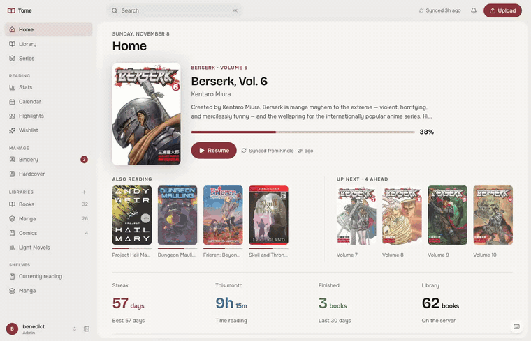
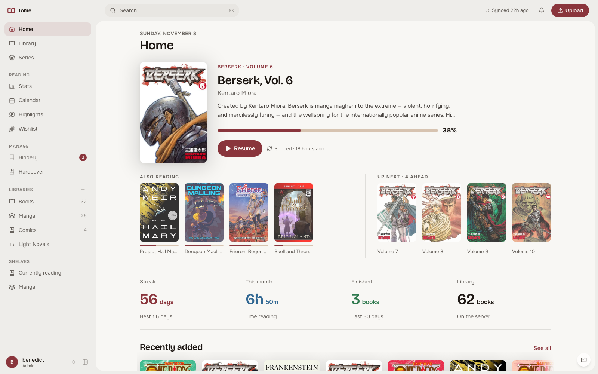

# v3.0.0 "Rebind"

To rebind a book is to give it a new cover and spine and leave the pages as
they are. That is this release: every page of the web app was rebuilt in one
quiet vocabulary, and the server, your data and the KOReader plugin did not
change. The old look stays one setting away.

<!-- Video: drag the launch MP4 (tome-3.0-launch.mp4, path in the handover) into this
     release's description; GitHub turns it into a player. The GIF below
     is the fallback for the README. -->





## Highlights

- **One frame for every page.** A full-height sidebar with three groups,
  a lineless header with a pill search, and the page itself as a rounded
  panel set into the frame. Library, Series, Stats, Calendar, Highlights,
  Wishlist, Bindery, Hardcover, Settings and Admin follow the same rules:
  one page header with the actions on the right, pill buttons, rows on
  hairlines instead of boxes. All five themes, phones included.
- **Home is about the book you are reading.** Cover, progress, Resume, the
  other books in progress in one row, the next volumes of the series beside
  them, four bare numbers, Recently added, a highlight and recent activity.
  Focus and Dashboard modes are gone; there is one Home.
- **Every dialog on one shell.** Upload, Fetch metadata, Cover picker,
  Share, Send to device, Manage series, the bulk actions, What's new, the
  Admin forms and every confirm share one panel: pinned title, pills in a
  footer, Escape and a click outside to close, centred over the page.
- **A quick look from any cover.** Description, progress, reading time,
  Read and Open page, without leaving the grid you are in. Stats keeps its
  drag-and-drop boards but loses the card frames.
- **The previous look is one setting away.** `TOME_UI=classic` serves the
  2.8 interface, built into the image from its tag, for anyone who wants to
  stay with it for a while. Same server, same data.

## Also in this release

- Preview a book in the web reader without touching progress or stats.
- Hardcover tokens work with or without the "Bearer" prefix, for the pasted
  token and for `TOME_HARDCOVER_TOKEN`.
- Sentence case throughout, round chart ticks, a neutral focus ring, and a
  long list of small fixes that a full-size review of every screen turned
  up. The complete list is in the changelog below.

## Upgrade

```
docker pull ghcr.io/bndct-devops/tome:latest && docker compose up -d
```

No configuration changes and no migrations. The new interface is the
default; set `TOME_UI=classic` on the container to keep the 2.8 look. The
KOReader plugin is unchanged (build 52). French and Chinese translations of
strings that only changed case were carried over; the strings the new
interface added are in English until the community catalogs catch up.

Found something broken or missing? Tell us in the discussion:
https://github.com/bndct-devops/tome/discussions/THREAD_NUMBER

---

## Full changelog

### Added
- **Preview a book without touching your progress.** The book page has a
  quiet "Preview" next to Resume: the book opens in the web reader as usual,
  but nothing is written back. Reading status, position, the
  position synced to your devices, reading time and stats all stay as they
  were, so you can check a file's formatting or flip through a book to decide
  on it without it turning up as started. The reader shows a "Preview" tag
  while this is on. Highlights and notes still work. (#289)

### Changed
- **A quieter web app.** Every page now shares one frame: a full-height
  sidebar with the wordmark on top and the navigation in three groups (Home,
  Library, Series; Reading; Manage), a lineless header with a pill search and
  a "Synced 5d ago" chip that says what it is, and the page itself as a
  rounded panel set into the frame. Home is rebuilt around the book you are
  reading: cover, progress, Resume, the other books in progress as one row,
  four bare numbers (streak, this month, finished, library), Recently added,
  a highlight, and recent activity as plain rows. The book page moves inside
  that frame with the cover, file, details and genres in a rail beside the
  content; its charts are unchanged. Library, Series, Stats, Calendar,
  Highlights, Wishlist, Bindery, Hardcover, Settings, Admin, the login and
  the public share page follow the same vocabulary: one page header with the
  page's actions on the right, pill buttons, rows on hairlines instead of
  boxes, and two content widths. Settings and Admin swap the sidebar for their
  own section list while they are open. A quick look opens from a cover in
  any grid or row (cover, description, progress, reading time, Resume, Open
  page) without leaving the page. All five themes.
- **Every dialog on one shell.** Upload, Fetch metadata, Cover picker, Share,
  Send to device, Position history, Manage series, Add shelf, New library,
  the bulk actions, What's new, Connect a phone, Scan a sync code, the Admin
  forms and every confirm now share one panel: a pinned title, the actions as
  pills in a footer, rows on hairlines inside, drawn checkboxes and radios
  instead of the browser's, Escape and a click outside to close. Dialogs
  centre over the page, not the window, so they sit where you are looking.
  What's new reads as a list grouped by Added, Changed and Fixed.
- **Stats without the boxes.** The tiles on every Stats board keep their
  drag-and-drop layout but lose the card frames: bare numbers in a strip,
  charts under plain section titles on hairlines, tiles that size to their
  content. Edit mode shows the frames as dashed outlines while you arrange.
- **The reader's chrome follows.** Font, theme and tap-zone choices are pill
  rows, the contents drawer is a plain list with the current chapter marked,
  the comic toolbar fits a phone, and Escape closes whatever panel is open.
- **Sentence case throughout, and no more dashes in the middle of sentences.**
  Buttons, menus, filters and section titles read "Fetch metadata", "Date
  added", "Want to read". French and Chinese translations of strings that only
  changed case were carried over; the strings the refresh added are new and
  wait for the community catalogs.
- **The previous look is one setting away.** `TOME_UI=classic` serves the
  interface of the last 2.x release, built into the image from its tag, for
  anyone who wants to stay with it for a while. It is the same server and
  the same data; new features from here on appear only in the new interface.
- **Stats opens faster.** The stats answer computed the same gap-clustered
  sessions up to ten times per request; it now does so once, which roughly
  halves the server time. Stats and Calendar also keep their last answer
  for the session, so coming back to either page paints at once and
  refreshes underneath.

### Fixed
- **Escape no longer leaves the book page while a dialog is open.** It closes
  the dialog, the menu or the edit form first; only with nothing open does it
  go back. The same applies to the library shortcuts (j, k, Enter) while
  anything is open.
- **A failed download shows a notice instead of replacing the book page.**
- **A wrong password says so.** The login form keeps the username and shows
  the error instead of silently clearing both fields.
- **Keyboard focus and selection are visible in the library grid again.** The
  cover glow had been drawn over the focus ring.
- **Settings and Admin section navigation works on phones.** Tapping a section
  scrolls to it; the list is a scrollable row above the page.
- **Popovers stay on screen at phone width:** the notifications panel, the
  book page's Libraries menu and the Fetch metadata diff.
- **"Last sync: Invalid Date"** in Settings > KOReader shows the real time.
- **Year in review fills in for the 1y range,** not only for All, and a stats
  answer that arrives late for a range you already left is ignored.
- **The Bindery's reject confirm says Reject,** not Delete, and closes on
  Escape. Remove device, revoking tokens and sessions, and Reorganize ask
  with a proper confirm instead of the browser's own or none.
- **Going back from a book to its series page** returns to the series page at
  the same scroll position; the series page now has its own address.
- **Comics on a phone no longer overflow the screen,** and a click in the
  middle of a comic page shows the toolbar instead of turning the page.
- **The calendar's month switch** keeps the old month dimmed until the new one
  is in, and nothing fades in from nothing.
- **Hardcover tokens work with or without the "Bearer" prefix.** Hardcover's
  token page shows the value with "Bearer " in front and its API insists on
  it; Tome now adds the prefix once itself, for the token you paste in
  Settings and for `TOME_HARDCOVER_TOKEN`, so both forms work everywhere
  (metadata fetch, release detection and sync).
- **Charts and tables read cleanly.** Stats charts use round ticks (whole
  hours, even day spacing, no repeated dates), the session timeline has one
  shared axis, percentages are whole numbers, and figures in running text no
  longer show a gap after a 1 ("1 1h"). Dates in admin tables read "Nov 7,
  2026". The calendar's out-of-month days line up with the rest, the phone
  drawer lists libraries and shelves again, the Word counts tab says what it
  will count, and fetched descriptions drop stray markdown marks.
- **Highlights are visible in the sepia reader.** Each highlight colour has a
  sepia variant with enough contrast on the cream page; the colour picker and
  the highlight card use the same. Stats charts take their colours from the
  theme instead of a fixed indigo and violet set, and the rating trend sits on
  a real time axis.
- **Smaller fixes:** the "Read on the web" line on Home no longer looks like a
  button; the hero book is not repeated in Also reading; Quick look keeps
  paragraph breaks; "0 book" plurals in French; a gap after the digit 1 in
  dates and counts; the black theme's search field has a fill; the public
  share page is centred.

### Removed
- **Home's Focus and Dashboard modes.** There is one Home now. Reading DNA
  stays on the Stats page, series progress on its Library tab, and recently
  finished books are the Library's "Read" filter. The forgotten-books
  reminder is gone.
