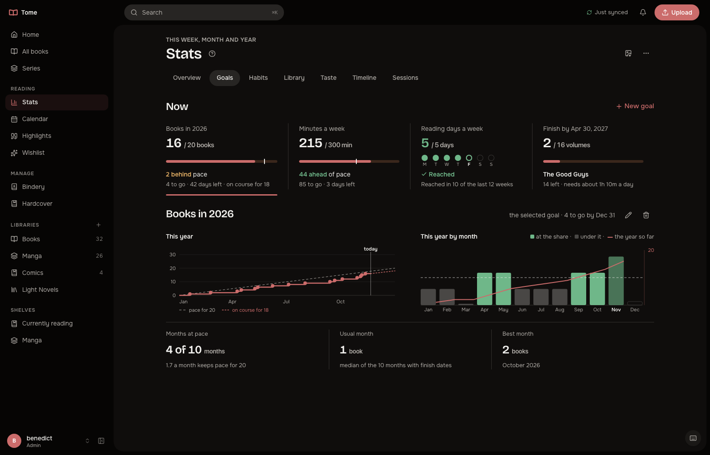

# v3.1.0 "Tally"

A tally is a count kept by marks. This release rebuilds Stats into fixed
pages and makes reading goals a part of them.



## Highlights

**Stats in seven pages.** Overview, Goals, Habits, Library, Taste, Timeline
and Sessions replace the board of tiles. Each page answers one question and
looks the same for everyone. The rearrangeable boards are still there:
Settings > Appearance > Stats has a "Show Boards" switch, and anyone who
built a board of their own keeps seeing it.

**Reading goals.** The Goals page shows each goal as a card: how far you
are, whether you are ahead of or behind pace, and what it takes. Click a
card for its history. Home shows up to four goals, the ones that need
attention first. Goals now count calendar weeks, months and years with the
same numbers as Stats.

**Two new kinds of goal.** "Reading days a week" counts the days you read.
"Finish by a date" takes a book or a series and a day, and tells you how
much reading a day that needs at your own pace.

**Set a goal where you are.** Home has "Set a reading goal", and series and
book pages have "Finish by…". The dialog suggests targets from your own
last 90 days.

**Spanish.** The web UI is available in Spanish, contributed by
PedroFlores199. (#314)

## Also

- Sort and filter the library by length, contributed by cliophate. (#313)
- KOReader shows the reading status from Tome: a book finished on one
  device is marked finished on the others.
- "Week starts on" under Settings > Language and region, Monday or Sunday.
  Goals, the calendar, the weekly streak and the Stats charts follow it.
- A long series shows one coverage bar instead of a chip per volume.
- Settings and Admin sections have their own addresses, and everything that
  can sign in to your account is under Settings > Access.
- Ten security fixes, among them: members only reach books they can see,
  script inside a book no longer runs in the web reader, repeated wrong
  passwords slow down, and uploads have a size limit.
- 33 fixes. The complete list is in the changelog below.

## Upgrade

```
docker pull ghcr.io/bndct-devops/tome:latest && docker compose up -d
```

Nothing has to be configured. One change to know: a member's notification
channel that points at a host on your local network (a local ntfy or
Gotify, for example) stops sending until you add that host to
`TOME_WEBHOOK_ALLOWED_HOSTS`. Uploads are now limited to 4 GB by default
(`TOME_MAX_UPLOAD_MB`).

On first start Tome adds a few columns and one table for goals; existing
goals are kept. Weekly goals used to count the last seven days and now
count the calendar week, so their numbers can differ from before.

KOReader: the reading status from Tome needs TomeSync build 55 (1.20.1;
3.0.0 shipped build 52). The plugin updates itself (Settings > Check for
updates, or enable auto-check on launch).

Spanish arrived fully translated; the strings added after it are in English
in Spanish and French until the catalogs catch up.

Found something broken or missing? Tell us in the discussion:
https://github.com/bndct-devops/tome/discussions/323

---

## Full changelog

### Added
- **KOReader shows the reading status from Tome.** A book you finish on one
  device, or mark read in the web UI or the app, now shows as finished in
  KOReader's file browser and Book status screen on your other devices. The
  plugin applies it shortly after launch, when the device wakes, when WiFi
  connects and with "Sync now". Only a change in Tome is applied, so a status
  set by hand on the device stays until then; books "On hold" and the book
  that is open are left alone. On by default, with a switch in the plugin's
  settings ("Apply Tome reading status to this device"). Plugin build 54
  (1.20.0); the rules are in the KOReader plugin docs under "Reading status on
  the device". (#296)
- **Sort and filter the library by length.** The sort menu has a new "Length"
  option, shortest first; pick it again to reverse. Filters has a Length row
  with a minimum and maximum word count. Books without a word count sort last
  either way and are hidden once a bound is set. The bounds work with the
  other filters, select-all and saved shelves, including shelves in the
  KOReader plugin and the backlog estimate. Contributed by @cliophate (#313).
- **Spanish translation.** The web UI is available in Spanish (Settings →
  Language and region), with every string translated when it was contributed;
  strings added later in this release show in English for now. Contributed
  by @PedroFlores199 (#314).
- **Descriptions in the book list, on request.** `GET /api/books` accepts
  `include=description` to add each book's description to the list items, so
  a client that keeps an offline copy of the library needs no request per
  book. Without it the reply is unchanged.
- **A Goals tab in Stats.** It comes after Overview and shows each reading
  goal as a card: how far you are against the target, how far ahead of or
  behind pace, and what it takes. Click a card for the goal in detail: the
  period so far, past periods against the target, and your best and current
  runs. Overview keeps one row of up to four goals.
- **Goal cards on Home.** Home shows the same cards under its four numbers,
  one row of up to four: the goals behind pace first, reached ones last. Click
  one to open it on the Goals tab; with more goals, "See all" opens the tab.
- **Set a goal where you are.** Home offers "Set a reading goal" under its
  numbers when you have none, and "New goal" under the goal cards when you do;
  both open the goal dialog right on Home. A series page and a book page have
  "Finish by…" among their actions: it opens a small dialog for that title
  with just the day and what it takes a day. When the title already has a
  finish-by goal the button shows its day and opens the goal to change it; a
  series or book you have read offers none.
- **Two new kinds of goal.** "Reading days a week" counts the days you read,
  as the streak does. "Finish by a date" takes a book or a series and a date,
  and shows the minutes a day that takes at your own pace next to what you
  have read a day lately.
- **A shorter goal dialog.** The eight kinds are one row of choices, the target
  comes right under them with the book type beside the number, and the dialog
  fits on one screen on a phone. Its top stays put when you switch kinds; only
  "Finish by a date" makes it taller. Suggested targets that come out the same
  are offered once.
- **Suggested targets.** The new goal dialog suggests three targets from your
  own reading over the last 90 days (12 weeks for weekly goals), each with
  how often you reached it. Without enough history it offers fixed targets.
- **Undo for a deleted goal.** A deleted goal can be brought back for 30
  minutes, with its history.
- **Week starts on.** Settings → Language and region (formerly Language) has
  a "Week starts on" setting, Monday or Sunday. Weekly goals follow it, and
  so do the Calendar, the weekly streak and the Stats charts by weekday.
- **Goals API for other clients.** `/api/goals` has new fields (name, status,
  pace, projection, the week's days), takes `tz` (an IANA zone) next to
  `tz_offset`, and adds `/history`, `/kinds`, `/suggestions`,
  `/finish-preview` and `/{id}/restore`. `DELETE` is now a soft delete that
  `/restore` can undo for 30 minutes. `week_start` is on `/api/auth/me`.

### Security
- **The web server only serves files from its own interface folder.** A
  crafted path could make it return a file from outside that folder. Updating
  is recommended.
- **Members only reach books they can see, and only change books they
  uploaded.** The bulk edit, metadata, cover, Bindery, export and KOReader
  plugin routes now follow the same two rules as the rest of Tome. On a book
  someone else uploaded, the book page no longer offers Edit, Fetch metadata,
  the cover picker or Delete to a member, and a bulk edit says how many books
  it left alone.
- **Script inside a book no longer runs in the web reader.** The web
  interface now sends a Content-Security-Policy that blocks it, while the
  book's own styles, fonts and images still load. Set
  `TOME_CONTENT_SECURITY_POLICY=off` only if a proxy or setup of yours breaks
  with it.
- **Members' notification channels can no longer reach your local network.** A
  channel that does not belong to an admin must now be a public internet
  address, checked when it is saved and again on every send. No channel
  follows redirects, and a member's Test button no longer shows the server's
  error text. To let members use a local ntfy or Gotify, list its host in
  `TOME_WEBHOOK_ALLOWED_HOSTS`. A channel that is no longer sent is marked in
  Settings with the reason, its owner gets one notice in the bell, and the
  form now says why a new channel was refused.
- **An account with a temporary password can only change it.** Until the new
  password is set, the account is refused everywhere else, including API
  tokens, OPDS, KOSync and the KOReader plugin. Before, only the web interface
  enforced the forced change.
- **Uploads have a size limit, and two uploads with the same file name no
  longer collide.** `TOME_MAX_UPLOAD_MB` (default 4096, 0 = no limit) refuses
  bigger uploads before they reach the disk. Every response now also carries
  basic security headers. Cover fetching connects only to the address it
  checked, and the Bindery and backup restore check paths more strictly.
- **The web reader no longer puts your sign-in in page URLs.** Comic pages now
  load with a 12-hour pass that opens only that book, and EPUB and PDF books
  send the sign-in as a header, so it no longer shows up in proxy logs or
  browser history. Apps that still pass a sign-in in the URL keep working.
- **Repeated wrong passwords now slow down.** After five wrong passwords in a
  row for one account from one address, the web login, OPDS and KOSync make
  you wait, starting at a second and growing to a minute. A correct sign-in
  resets it, and other users behind the same reverse proxy are not affected.
- **New OPDS PINs are longer.** PINs now have 10 characters instead of 6, and
  the list shows only their first character. Existing PINs keep working.
- **API tokens can no longer create other credentials.** Creating API tokens,
  plugin keys, OPDS PINs, Quick Connect codes and the KOSync link, and
  downloading the KOReader plugin, now require a normal sign-in. Scripts that
  use a token to manage books are unaffected, and so is the plugin's
  self-update.

### Changed
- **Stats has seven fixed pages.** Overview shows reading time, sessions,
  pages, books finished and your streak, your reading goals, the books you are
  reading now, the year as a grid, and all-time totals and records. Goals
  shows each goal's pace, its history and what it takes. Habits
  shows when you read, the last 14 days, session lengths, pace, reading speed,
  the last 12 months and your reading character. Library shows your library,
  series with their next volume, book types, languages, authors, the backlog,
  book lengths and what you added. Taste shows your ratings and how they
  relate to the time you spent. Timeline shows every book as a bar across the
  years. Sessions lists every session by day, with trim and delete. Each page
  keeps its layout while it loads.
- **Boards are no longer the default Stats view.** The rearrangeable boards
  remain available through Settings → Appearance → Stats → Show Boards.
  Anyone who customised a board keeps seeing the Boards tab automatically.
- **Reading goals count the way Stats does.** A goal counts its calendar
  period (this week, month or year), with the same reading time, pages and
  reading days as Stats and the same 4 a.m. day boundary. Weekly goals used
  to count the last seven days and now count the calendar week, so their
  numbers can differ from before. Reaching a weekly goal now also sends a
  notification. Existing goals are kept; on first start Tome adds the new
  goal columns and a table for target changes to the database.
- **Tome's own log lines now reach the container log.** Informational
  messages (auto-import, Hardcover sync, restore) were dropped before, and
  warnings came without a time or level. Every line now has both. Set
  `TOME_LOG_LEVEL` to `DEBUG`, `WARNING` or `ERROR` to change how much is
  logged (default `INFO`).
- **Changing your password can revoke your tokens, keys and PINs.** A new
  checkbox in Settings also revokes your API tokens, KOReader plugin keys,
  OPDS PINs and KOSync link, so the devices that use them need to be set up
  again.
- **Admin impersonation now lasts one hour instead of seven days.** When it
  runs out, the browser returns to the admin's own session instead of the
  login page.
- **Admin sections have their own address and are grouped.** Refreshing keeps
  the open section, the back button steps between sections, and the navigation
  is sorted under People, Library, System and Requests. The upload message
  about matching wishes now has a button that opens the Wishlist.
- **Each Settings section is its own page.** Settings no longer loads
  everything at once: a section loads its data when you open it, and old links
  still land on the right section. "Export" is now "Export catalogue" and the
  personal backup is "Download my data".
- **Everything that can sign in to your account is under Settings > Access.**
  Quick Connect, connected devices, plugin keys, OPDS PINs, the sync password
  and API tokens sit together, each with a line on what it is for. The
  KOReader plugin's "API keys" are now called "Plugin keys".
- **Downloading the KOReader plugin no longer piles up keys.** Each download
  removes your earlier download keys that no device ever used and that are
  over a week old, and the new key is labelled with the date. Keys a device
  has used are never removed.
- **Clearer names in the sidebar and on the book page.** The full book list is
  now "All books", and the reading status "Shelved" now shows as "On hold".
  When the sidebar is collapsed, hovering or tabbing to an icon shows its
  name.

### Fixed
- **A long series no longer shows hundreds of volume chips.** The "In the
  library" list on a series page (and the coverage strip on a whole-series
  wish) drew one chip per volume, so a series with hundreds of volumes or
  chapters ran several screens down. From 25 volumes on it is one coverage
  bar, filled where the volumes are in the library, with the missing ranges
  listed under it ("Missing: 111-198, 208-210").
- **The "Read" button in Quick look is a verb in every language.** It shared
  its text with the "Read" status, so in Spanish it said "Leído" where "Leer"
  was meant.
- **The sign-in-with-a-code hint points to the right place.** It sent you to
  Settings → Security; Quick Connect is under Settings → Access.
- **The API docs show the real version.** `/api/docs` reported 1.7.0 whatever
  release was running.
- **Build tooling: minimatch 11 for the lint and build dependencies** that
  pulled a 10.x with a known denial-of-service pattern. Development
  dependencies only; nothing in the image changes.
- **The arm64 image builds again.** The two frontend build stages run on the
  build host instead of under emulation; the 3.0.0 image build had crashed
  there while compiling the classic bundle.
- **The web reader no longer un-marks a book you just finished.** A page save
  from the last few seconds could land after the reader marked the book read,
  clearing the finish date. Opening a finished comic or PDF also reset its
  progress and the position synced to your device. Reader saves now leave a
  finished book finished, as KOReader sync already did. "Reading again" on the
  book page still starts the book over.
- **Leaving the web reader right after turning a page no longer loses your
  place.** The last position is now sent when you close the reader or the tab,
  or switch away from the app, instead of being dropped.
- **Opening a book in the web reader for a few seconds no longer counts as a
  streak day.** Web reader visits shorter than a minute stay in your history
  but no longer start or extend a streak, so Home, Stats and the Calendar
  agree. Short sessions from KOReader devices still count.
- **Going to the next or previous volume no longer shows the previous book's
  highlights, stats or estimate.** The book page now loads each volume from
  scratch, so a slow or failed request for the old volume can no longer
  overwrite the new one.
- **Deleting a user who uploaded books works again.** It used to fail with a
  server error while the audit log already recorded the deletion. Their books
  and libraries now pass to the admin who deleted them, their shelves are
  removed, and uploads that were private to them are kept private in a new
  "Uploads from" library named after them.
- **"Clear cover cache" no longer deletes your covers.** It removed every
  stored cover, including fetched and uploaded ones, and nothing brought them
  back. It now clears only the resized thumbnails, which are made again when
  next shown.
- **Auto-import waits for files to finish copying.** A book dropped into the
  Bindery is left alone until it has not changed for 30 seconds, so a
  half-copied file is no longer imported.
- **Books finished are counted on the day you finished them.** Stats, Home,
  reading goals, the monthly chart and words-by-year used the last time a
  book's status changed, so rating or reviewing an old book counted it as
  finished that day and could complete a goal. They now use the finish date,
  the same one the Calendar and Hardcover already used.
- **The time-left estimate no longer shows figures like "~2153 months".**
  After a reading break the average daily reading time is close to zero, and
  dividing by it gave absurd numbers. Under one minute a day there is no day
  estimate, longer estimates are shown in years, and anything past ten years
  reads "more than 10 years".
- **Monthly stats charts no longer repeat or skip a month.** The month axes
  stepped back 30 days at a time, so viewed on the 31st one month appeared
  twice, February was missing, and library growth miscounted. They now step
  real calendar months.
- **KOSync no longer attaches another file's progress to a book you downloaded
  over OPDS.** A download used to leave a link with no expiry that the next
  unknown file could claim, so a sideloaded book's progress (and finish) could
  land on it. The link now goes away once the book is matched and expires
  after 15 minutes.
- **A TomeSync self-update no longer changes the plugin's server address to a
  home network address.** Updating while the fallback address was in use made
  that address the plugin's default, so the device stopped syncing away from
  home. The plugin now tells the server its main address and keeps it
  (TomeSync 1.20.1).
- **Reading a book that is not in Tome no longer slows down page turns in
  KOReader.** The plugin asked the server about the book on every page turn;
  it now asks again only after five minutes or when WiFi reconnects
  (TomeSync 1.20.1).
- **Usernames and server addresses with quotes or backslashes no longer break
  the TomeSync plugin.** These values are now escaped when the plugin is
  generated, and a self-update that cannot write its files (for example on a
  full disk) stops instead of installing a broken copy (TomeSync 1.20.1).
- **The Bindery no longer reloads after every message.** Each notification
  re-ran its three list requests, and a failed load kept reloading itself.
- **A page that fails to load now offers a Reload button instead of a blank
  screen.** After an update, an open tab reloads once on its own when a page's
  script is no longer there.
- **Home no longer asks for followed series when release detection is off.**
  The server now tells the app whether the feature is on, so the request that
  always failed is gone.
- **Book covers in the Library grid are real links, and pages can be zoomed.**
  Covers can be opened in a new tab, middle-clicked and reached with Tab.
  Pinch zoom works again; the comic reader keeps its own zoom.
- **Add shelf saves every active filter, and the Type filter is part of the
  link.** A shelf made from "Author X + Reading" now keeps the status, rating,
  missing-data, ownership and uploader filters. Chapters/All is in the address
  and shows as a chip.
- **Bulk Send no longer sends fewer books than are selected.** When Select all
  reaches past the loaded books, Send waits and its tooltip says how many
  books are not loaded yet.
- **A book saved at 100% is marked as read on every path.** KOReader sync
  already finished a book at 99%; a position saved through the web API (the
  iPhone app, scripts) left it "reading" at 100% for good. For books already
  in that state, Currently reading on the Stats page now offers Mark as read,
  and books at 0% are listed last.
- **The Calendar no longer shows 0 pages and 0 p/h for days without page
  data.** Web reader sessions have no page count, so pages and speed are left
  out on those days.
- **Connected devices can be told apart on a phone.** Each device shows its
  system and when it was last seen under its name, with the delete button at
  the row's edge.
- **Page titles stay in one place when moving between pages.** Admin,
  Settings, Wishlist and Highlights now line up with Home, Library and Stats
  instead of starting further to the right.
- **The series page's reading stats no longer repeat the percentage.** The
  header right above already shows it.
- **Stats tiles show when they scroll and shrink when empty.** A list cut at
  the tile edge now has an edge line, and tiles with only a "nothing yet"
  message take one row instead of a full chart's height.
- **The Bindery lists each file once.** Files in a series group appear only
  there, and a volume chip opens that file on its own. "Recently imported" is
  now called "Waiting for review".
